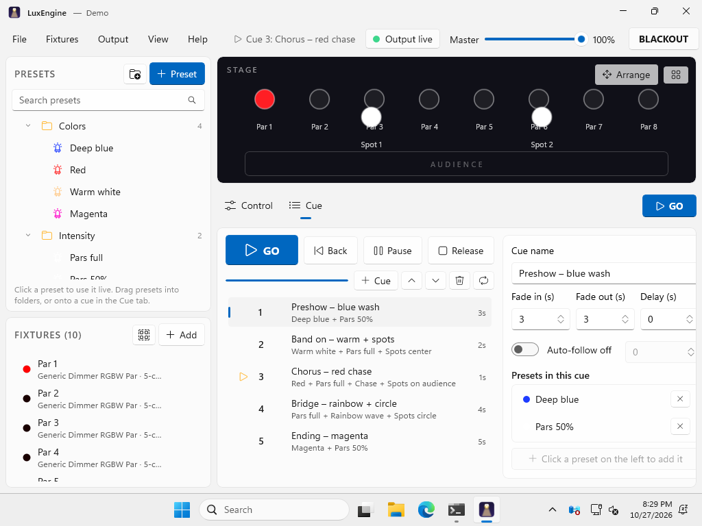
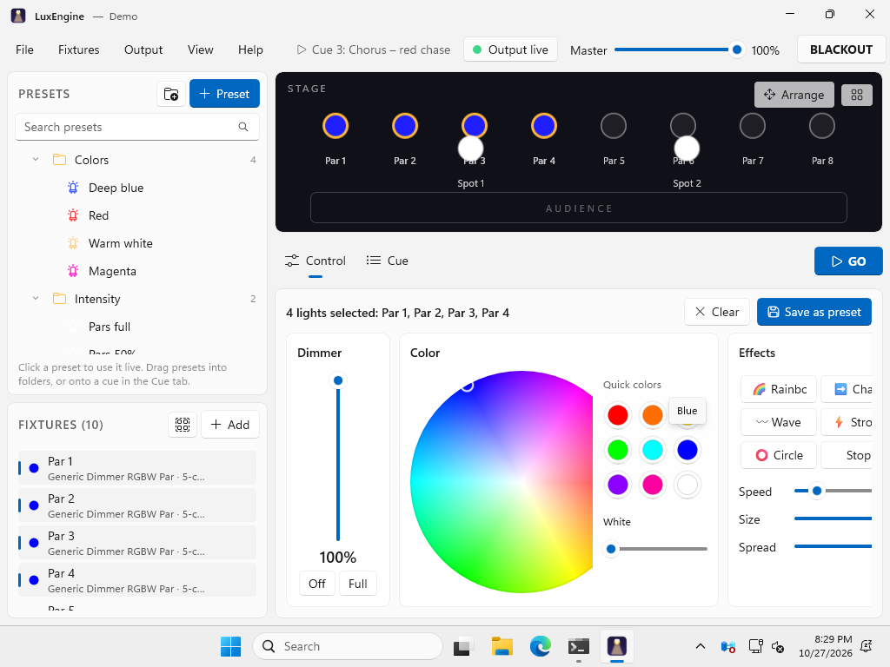
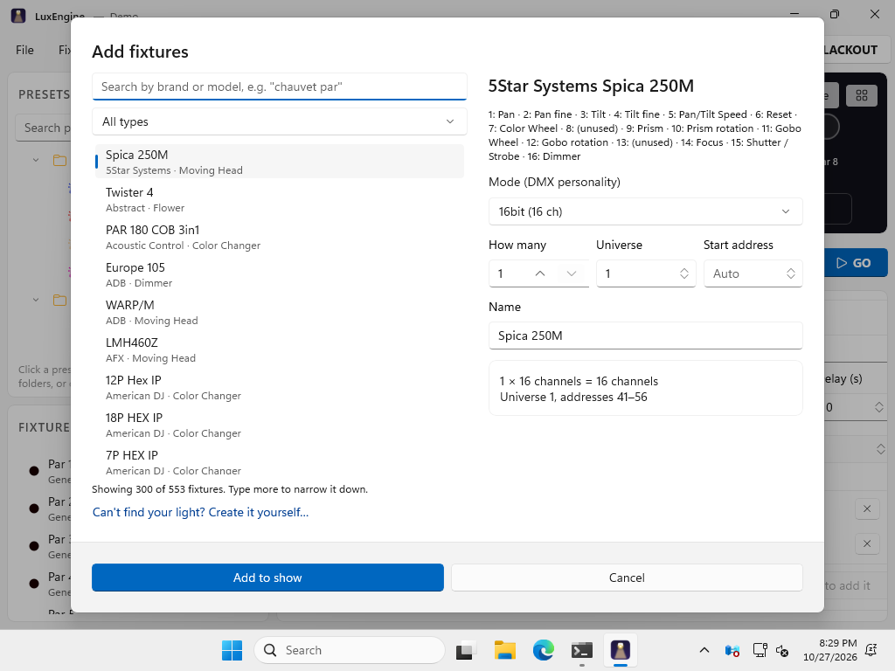

<p align="center">
  
</p>

<h1 align="center">LuxEngine</h1>

<p align="center">
  Free, open-source DMX lighting control for Windows.<br/>
  Patch your lights, build looks, save them as presets, combine presets into cues and press GO.
</p>

<p align="center">
  <a href="https://github.com/vothalvino/LuxEngine/releases/latest"><b>⬇ Download LuxEngine for Windows</b></a>
</p>

<p align="center">
  
</p>

---

## Features

- **Presets in folders.** The left panel holds your saved looks in folders. Click a preset to use it live, drag to reorganize.
- **Control and Cue in one place.** The area under the stage switches between **Control** (dimmer, color wheel, quick colors, pan/tilt pad, effects, beam channels) and **Cue** (your cue list).
- **Cues made of several presets.** A cue can combine, for example, "Blue wash" + "Spots center" + "Slow rainbow", with its own fade in, fade out, delay and auto-follow.
- **Hundreds of fixtures built in.** More than 500 fixtures from the [Open Fixture Library](https://open-fixture-library.org) (Chauvet, ADJ, Eurolite, Stairville, Cameo, Martin, Robe, Showtec, generic pars and more). If your light isn't there, create it in a simple form.
- **Live stage view.** See every light's color and brightness. Select by clicking or dragging, and arrange lights to match your rig.
- **Effects.** Rainbow, chase, wave, strobe and circle, with speed, size and spread.
- **Outputs.** Art-Net, sACN (E1.31), Enttec DMX USB Pro and Open DMX USB, with as many universes as you need.
- **External control.** MIDI controllers (learn mode) and sound-to-light from music playing on the PC or a microphone.
- **Safe for live use.** Blackout, master fader, autosave with crash recovery, and keeps Windows awake during a show.

## Screenshots

| Live control | Fixture library |
|---|---|
|  |  |

These screenshots are taken automatically by the CI smoke test on Windows, using the bundled demo show (*Help → Open demo show*).

## Install

1. Download `LuxEngine-Setup.exe` from the [latest release](https://github.com/vothalvino/LuxEngine/releases/latest).
2. Run it. No admin rights are needed when you install "for me only".
3. Windows SmartScreen may warn that the app is unrecognized, because the installer isn't code-signed yet. Click **More info → Run anyway**.

Requires Windows 10 (1809) or newer, 64-bit. Windows 11 recommended.

**USB interfaces:** Enttec and compatible USB-DMX interfaces need the [FTDI VCP driver](https://ftdichip.com/drivers/vcp-drivers/). After installing it, the interface appears as a COM port under *Output → DMX outputs*.

## Quick start

1. **Output → DMX outputs**: choose Art-Net, sACN or your USB interface.
2. **Fixtures → Add**: search the library and add your lights. Their DMX addresses are filled in automatically.
3. Select lights, then set dimmer, color and position in the **Control** tab.
4. Click **+ Preset** to save the look into a folder.
5. In the **Cue** tab, add cues and drag presets onto them.
6. Press **GO** (or Space).

| Shortcut | Action |
|---|---|
| Space / Shift+Space | GO / Back |
| B | Blackout |
| Esc | Deselect all |
| Ctrl+N / O / S | New / Open / Save |
| F11 | Full screen |

## Building from source

You need Windows 10/11 and the [.NET 8 SDK](https://dotnet.microsoft.com/download/dotnet/8.0). Visual Studio 2022 with the *Windows application development* workload is the easiest way to work on the UI.

```powershell
git clone https://github.com/vothalvino/LuxEngine.git
cd LuxEngine
dotnet test tests/LuxEngine.Core.Tests
dotnet test tests/LuxEngine.Output.Tests
dotnet run --project src/LuxEngine.App -p:Platform=x64
```

To build the installer, install [Inno Setup 6](https://jrsoftware.org/isinfo.php) and run:

```powershell
dotnet publish src/LuxEngine.App -c Release -r win-x64 -p:Platform=x64 -o publish
iscc installer\LuxEngine.iss
```

GitHub Actions builds, tests and creates the installer for every push. Pushing a tag such as `v1.0.0` publishes a release.

### Project layout

| Folder | What's inside |
|---|---|
| `src/LuxEngine.Core` | Fixtures, patch, presets and folders, cues, effects, the mixing engine and show files. No UI, fully unit-tested. |
| `src/LuxEngine.Output` | DMX output thread plus the Art-Net, sACN, Enttec Pro and Open DMX drivers. |
| `src/LuxEngine.Control` | MIDI input and sound-to-light. |
| `src/LuxEngine.App` | The WinUI 3 desktop app. |
| `fixtures/` | Bundled fixture library (JSON). |
| `tools/FixtureImporter` | Script that converts the Open Fixture Library into `fixtures/`. |
| `installer/` | Inno Setup script. |

### Updating the fixture library

```bash
git clone --depth 1 https://github.com/OpenLightingProject/open-fixture-library.git ofl
python3 tools/FixtureImporter/ofl_import.py ofl/fixtures fixtures
```

## Contributing

Bug reports, fixture requests and pull requests are welcome. See [CONTRIBUTING.md](CONTRIBUTING.md).

## License

LuxEngine is released under the [MIT License](LICENSE). Fixture data comes from the Open Fixture Library (MIT). See [THIRD-PARTY-NOTICES.md](THIRD-PARTY-NOTICES.md).
